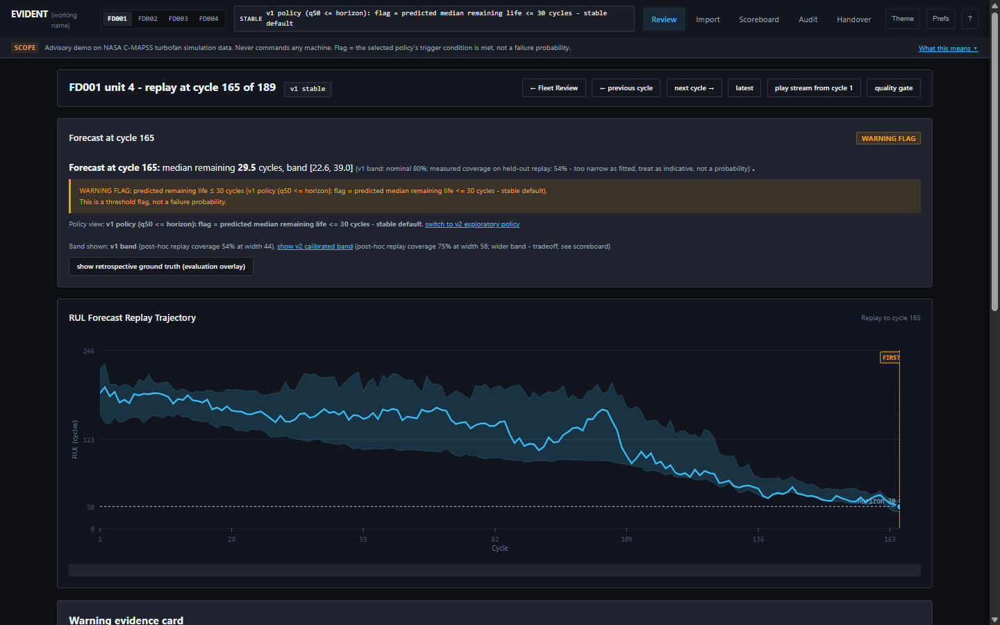
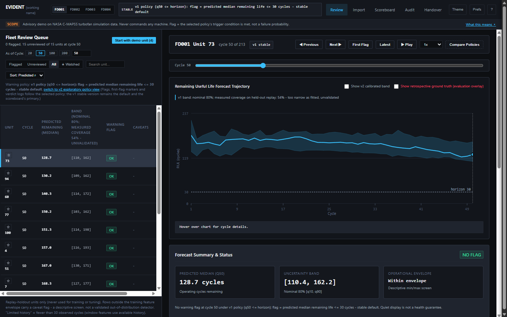
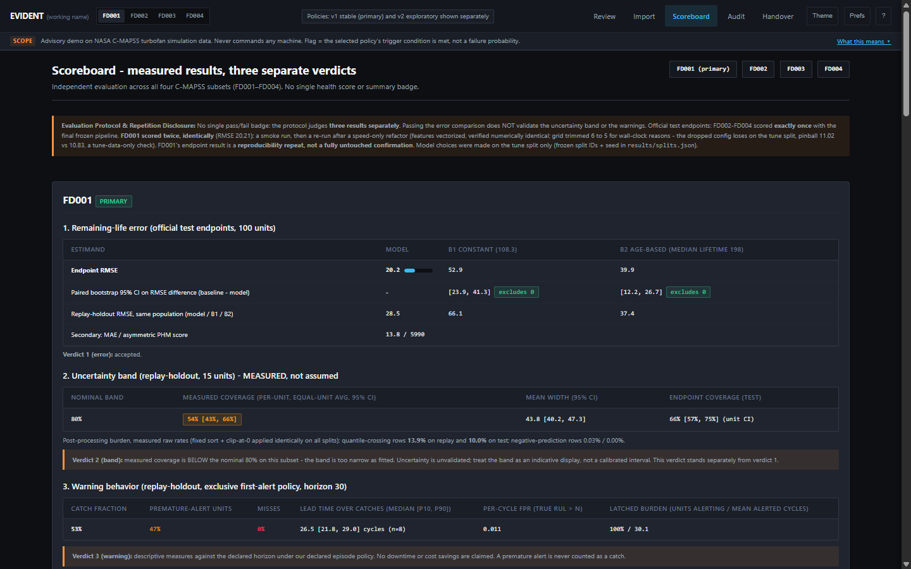

# EVIDENT (working name)
### Advisory remaining-life replay platform for predictive maintenance

**Neural Storm 2026 · FT-03 Predictive Maintenance · Solo entry by Nitish P (team `nitishprabagaran07`)**

| | |
|---|---|
| Live app | https://evident-of49.onrender.com (free hosting: first load can take about a minute to wake; verdicts and imports reset on restart) |
| Demo video (2:57) | https://drive.google.com/file/d/1Pjsg7cn0jxCB7I-dJJ41QuYn8oDXJHOs/view?usp=drivesdk |
| Code | https://github.com/NITISH-027/EVIDENT |



## What it does

EVIDENT replays NASA's C-MAPSS turbofan run-to-failure simulation data as a
maintenance engineer's review workspace. For every unit and cycle it shows:

- the predicted remaining operating cycles (median) with an uncertainty band,
- sensor trends against the unit's own past,
- a maintenance-warning flag ("predicted remaining life <= 30 cycles"),
- an engineer verdict, notes, an audit log and a printable shift handover.

It is advisory only: it never commands, stops or schedules any machine. When
evidence is thin or outside the training range, it says so instead of forcing an answer.



## Results at a glance

Official test endpoints, four separately trained models (one per C-MAPSS subset).
Lower RMSE is better. Baseline = predict from cycle count and median lifetime.

| Subset | Model RMSE | Baseline RMSE | Band coverage (target 80%) | Warning: caught / premature |
|---|---|---|---|---|
| FD001 (primary) | **20.2** | 39.9 | 54% | 53% / 47% |
| FD002 | **29.8** | 42.0 | 62% | 41% / 59% |
| FD003 | **21.3** | 48.4 | 46% | 47% / 53% |
| FD004 | **37.4** | 61.5 | 65% | 55% / 45% |

**Read this honestly:** the model beats both simple baselines on error in all four
subsets, with paired bootstrap confidence intervals excluding zero. But the
uncertainty band is too narrow (measured coverage is below the 80% it claims),
and 45-59% of first alerts are premature. These are reported on every screen,
not hidden. Full tables are in the app's Scoreboard.



## Scope and limits

- **Simulator data only.** No claim is made for real factory machines, and no
  downtime or cost savings are claimed.
- **"Ingestion" means** replay of recorded trajectories and import of files in
  the C-MAPSS schema. There is no live streaming (no MQTT, no database connector).
- Not an anomaly detector, not a drift monitor, and no numerical failure probability.
- On the brief's "few false alarms" challenge, the premature-alert share is
  45-59% of replay units, a real weakness.

## Data provenance

C-MAPSS (Turbofan Engine Degradation Simulation Data Set), downloaded from
NASA's Prognostics Center of Excellence repository:
https://www.nasa.gov/intelligent-systems-division/discovery-and-systems-health/pcoe/pcoe-data-set-repository/
Citation: Saxena, A., Goebel, K., Simon, D., Eklund, N. (2008), "Damage
Propagation Modeling for Aircraft Engine Run-to-Failure Simulation," Proc. PHM 2008.
No explicit license terms were found on the page or in the package. For offline
convenience this repository includes the 12 raw C-MAPSS `.txt` files in `data_raw/`
(about 43 MB), copied unmodified from NASA's public repository; their SHA-256
hashes are in `DATA_SHA256.txt`. They remain NASA's data, not this project's work,
and are included only for reproducibility. `bootstrap.py` can also re-download
them from NASA.

Known discrepancy (preserved, not silently resolved): FD004 files as downloaded
contain 249 train / 248 test units + 248 endpoint RULs; the bundled readme says
248/249. File contents are used as-is.

## Method (one paragraph)

Per C-MAPSS subset, one gradient-boosted quantile regression model
(scikit-learn `HistGradientBoostingRegressor`, three separately fitted heads
q0.1 / q0.5 / q0.9) predicts the **uncapped** true remaining life from
strictly-past trailing-window features (30-cycle mean / std ddof=0 / slope of
the 3 operating settings + 21 sensor channels, plus cycle index; short
histories use available cycles). Fixed post-processing on every split: order
the quantiles, clip at 0 (raw negative/crossing rates are reported). The
warning is a threshold flag at predicted RUL ≤ 30 — nothing stronger is claimed.

## Evaluation contract (frozen before training)

- Whole-unit split per subset: 70% fit / 15% tune / 15% replay-holdout;
  unit IDs and seed frozen in `results/splits.json` **before** training.
- All model choices (hyperparameters) selected on the **tune** split only.
- Baselines (fit rows only): B1 = pooled mean true RUL over fit unit-cycle
  rows; B2 = max(0, median fit-unit lifetime − cycle).
- Official test endpoints: FD002, FD003 and FD004 were scored **exactly once**,
  with the final frozen pipeline. **FD001 was scored twice with identical
  results** (endpoint RMSE 20.21): a first smoke run (6-config grid, loop-based
  features) and a re-run after a speed-only refactor (vectorized features,
  verified numerically identical to the loop version; grid trimmed 6 to 5,
  dropping max_leaf_nodes=15, for wall-clock reasons). The trim could not change
  selection: the dropped config loses on the tune split (pinball 11.02 vs the
  winner's 10.83, verified on tune data only, no test data involved). Because
  FD001's test number was seen before the refactor, FD001's endpoint result is a
  **reproducibility repeat, not a fully untouched confirmation**; FD002-FD004
  remain first-score results. All scores are at each test unit's last recorded
  cycle.
  Acceptance = endpoint RMSE beats BOTH baselines with paired unit-bootstrap
  95% CIs on the RMSE difference excluding 0; otherwise reported as
  inconclusive / no demonstrated improvement. No tuning against the test set
  was performed; any post-test change would be labeled exploratory.
- Replay-holdout (untouched, full trajectories): banded error including early
  life; band coverage/width per unit then equal-unit average with unit
  bootstrap CI; warning behavior under a declared exclusive first-alert
  episode policy (catch / premature / miss; lead time over catches; per-cycle
  FPR; latched alert burden — reported separately, never merged).

## Measured results (see app's Scoreboard for full tables)

| Subset | Test endpoint RMSE (B1 / B2) | Verdict 1: error | Verdict 2: band coverage (nominal 80%) | Verdict 3: warning catch / premature |
|---|---|---|---|---|
| FD001 (primary) | 20.2 (52.9 / 39.9) | accepted | 54% — BELOW nominal, unvalidated | 53% / 47% |
| FD002 | 29.8 (59.2 / 42.0) | accepted | 62% — BELOW nominal, unvalidated | 41% / 59% |
| FD003 | 21.3 (74.6 / 48.4) | accepted | 46% — BELOW nominal, unvalidated | 47% / 53% |
| FD004 | 37.4 (72.1 / 61.5) | accepted | 65% — BELOW nominal, unvalidated | 55% / 45% |

The three verdicts stand separately: beating the baselines on error does NOT
validate the band or the warnings. The band is too narrow as fitted; the
warning policy catches about half of units inside the 30-cycle horizon under
the declared policy, with premature alerts reported as false positives, never
as catches. No downtime or cost savings are claimed.

## Version 2 (POST-HOC, exploratory - v1 above remains the shipped default)

v2 was developed AFTER the frozen v1 results were known. Every v2 number is a
post-hoc measurement on splits whose results were already visible; nothing
below is a confirmation. v1 remains the baseline, the shipped stable version,
and the app's default view. v2 is selectable per view and is always labeled
exploratory with its exact trigger condition; a v2 view without v2 results
shows an explicit UNAVAILABLE fallback, never a silent v1.

Two changes were evaluated:

1. **Empirical tune calibration of the band** (`src/calibration.py`): a
   conformal-style offset fitted on fit+tune rows only. No coverage guarantee -
   the tune split also selected v1's hyperparameters, and the cross-fitted
   variant reuses tune selection information, so cross-fitted numbers are a
   development diagnostic only. Replay/test numbers below are post-hoc
   measurements, never untouched confirmation.

2. **Exploratory warning policies** (`src/retrospective.py`): candidates
   scored on tune-split rows only and selected by the rule
   "tune catch not worse than v1, then minimum tune premature; if none
   qualifies, v1 kept". The RULE was declared before candidate scoring; the
   candidate set itself is NOT claimed predeclared (see the FD004 note in this
   paragraph) and no pipeline preregistration is implied - replay/test was
   never used for selection. The full
   candidate registry (including rejects and its disclosure history, with the
   q90 candidate's timing) is documented in `evaluate_v2.py`; run-1 outputs
   are archived in `results/archive/`. The FD004 persistence candidate was
   added after run-1 replay results were seen - it is itself post-hoc and is
   labeled as such. The selection rule had no miss constraint; misses
   INCREASED on FD002 and FD004 (0% -> ~3%) and that is disclosed, not hidden.

### Band (replay-holdout, post-hoc)

| Subset | v1 coverage at width | v2 coverage at width |
|---|---|---|
| FD001 | 54% at width 44 | 75% at width 56 |
| FD002 | 62% at width 65 | 79% at width 86 |
| FD003 | 46% at width 33 | 92% at width 151 |
| FD004 | 65% at width 94 | 69% at width 100 |

FD003's gain costs a ~4.5x wider band - not a clean win; width is reported
next to every coverage number.

### Warning policy (replay-holdout, first-alert, horizon 30; post-hoc)

| Subset | v2 policy | v1 catch / premature / miss | v2 catch / premature / miss | median lead v1 -> v2 |
|---|---|---|---|---|
| FD001 | q90 | 53% / 47% / 0% | 80% / 20% / 0% | 26.5 -> 19.5 |
| FD002 | q90 | 41% / 59% / 0% | 59% / 38% / 3% | 21.5 -> 16.0 |
| FD003 | q90 | 47% / 53% / 0% | 73% / 27% / 0% | 27.0 -> 25.0 |
| FD004 | persistence_3 | 55% / 45% / 0% | 63% / 34% / 3% | 19.0 -> 17.0 |

Retrospective outcome scoring (model decision vs recorded simulator truth,
equal-unit with unit-bootstrap 95% CIs, imported units excluded,
descriptive-correlated - not first-alert policy effectiveness) is in
`results/retrospective_decision_*.json` and the app's Audit log.

## Limitations

- Simulator data at cycle granularity; no generalization to real machinery is
  claimed. Field applicability is an aspiration, not a result.
- The uncertainty band under-covers on all four subsets (above).
- The envelope flag is a descriptive per-feature min/max screen, not a
  validated out-of-distribution detector.
- Constant channels are excluded as uninformative - zero variance over fit-split rows, by a per-dataset
  rule (FD001: several channels are constant by construction), not treated as
  sensor faults.

## Repository layout

- `src/config.py` — frozen protocol constants (window 30, horizon 30, 80%
  band, 70/15/15 split, seed, bootstrap settings)
- `src/data.py` — loading + schema validation (bad units rejected with reasons)
- `src/features.py` — strictly-past window features; fit-only normalizer/envelope
- `src/splits.py` — frozen whole-unit splits
- `src/baselines.py`, `src/model.py`, `src/evaluate.py` — contract machinery
- `run_pipeline.py` — one command: splits → train → tune → replay → test (once)
- `src/calibration.py`, `src/retrospective.py`, `evaluate_v2.py` — POST-HOC v2 evaluation (calibration, policy registry/selection, outcome scoring); never modifies frozen v1 artifacts
- `app/server.py` + `app/templates/` — Flask replay platform (fleet overview,
  unit replay, warning evidence card, engineer verify, audit log, scoreboard)
- `results/` — splits.json, per-subset results JSON, precomputed predictions

## Run it

```
pip install -r requirements.txt
# C-MAPSS files are already in data_raw/ (see Data provenance)
python3 bootstrap.py             # first launch: builds inference caches (re-downloads from NASA if files are missing)
python3 app/server.py            # http://127.0.0.1:7777
python3 run_pipeline.py          # optional full re-run: trains + evaluates all four subsets (~5 min CPU)
```

## Tests

```
python3 -m pytest tests/ -q
```

193 checks: schema validation, strictly-past feature leakage, split
reproducibility from the frozen seed, frozen-artifact recomputation (stored
metrics re-derived from stored predictions), every app route and import edge
case, audit dedupe, and the README's own numbers cross-checked against the
frozen artifacts. With `data_raw/` present, all 193 pass (verified on a clean
Python 3.10 install from `requirements.txt`).

## Tech stack

Python 3.10 primary. scikit-learn 1.7.2 (quantile gradient boosting), pandas /
NumPy (features and data), Flask 3.1.3 + Jinja (app), Matplotlib (charts),
joblib (artifacts). Exact pinned versions in `requirements.txt`; raw-file
hashes in `DATA_SHA256.txt`.

## AI tools disclosure

This project was designed and built with AI assistance (research, design
documents, code and evaluation harness), disclosed here per the competition
rules. The evaluation contract, its frozen artifacts (`results/splits.json`,
`results/results_FD*.json`) and the scoreboard are inspectable; claims in this
README are limited to what those artifacts show.

## Frontend (Watch Floor workspace)

The frontend is a dark graphite "Watch Floor" engineering review workspace built with vanilla HTML5, CSS3, and JavaScript (no npm, no external CDNs, fully offline-capable on Windows).

- **How to run:** `python app/server.py` (serves at `http://127.0.0.1:7777`).
- **Static assets:**
  - CSS: `app/static/css/tokens.css` (design tokens and themes), `layout.css` (master-detail and header layouts), `components.css` (charts, tables, queue cards), `print.css` (ink-friendly shift handover print styles).
  - JS: `app/static/js/prefs.js` (local preferences), `chart.js` (pure SVG RUL & sensor trend rendering), `queue.js` (review queue filtering, sorting, keyboard navigation), `evidence.js` (evidence panel controller, scrubber, playback), `verdict.js` (progressive enhancement review verdicts & notes), `shortcuts.js` (global keyboard shortcuts & cheat sheet).
- **New endpoints:**
  - `GET /api/fleet?subset=&cycle=&version=`: fleet table data and review statuses.
  - `GET /api/unit/<subset>/<unit>?cycle=&version=&band=&show_truth=`: full unit replay trajectory (pure read; ground truth omitted unless `show_truth=1`).
  - `GET /api/unit/<subset>/<unit>/sensors?cycle=`: top 4 trend channels against past baseline.
  - `GET /api/review-status?subset=&policy=`: verdict log entries.
  - `GET /api/audit-summary`: handover summary aggregations from audit log.
  - `POST /api/display-flag`: explicit display logging when a flagged frame is rendered in the evidence panel.
  - `POST /api/note` & `GET /api/notes`: optional engineer free-text notes stored in `results/review_notes.jsonl`.
  - `GET /handover`: printable shift handover report.
- **State management:**
  - Browser-stored (`localStorage` prefix `evident.prefs.`): UI theme (dark/light/system), density, text size, reduced effects, queue filter/sort, watched units, starting view preset (Engineer, Manager, Analyst).
  - Server-stored: review verdicts, displayed flags, and upload manifests appended to `results/audit.jsonl`; engineer notes appended to `results/review_notes.jsonl`.
- **Deliberately not implemented:** real aircraft or live fleet streams, numerical failure probabilities, machine health grades, automated work order generation, replacement parts scheduling, physical root cause attribution, machine control actions, or user logins/accounts.

## Process disclosure

Implementation started 2 Nov 2026, 12:48 IST, on the participant's report of team
permission to begin early; independent organizer confirmation was not obtained.
